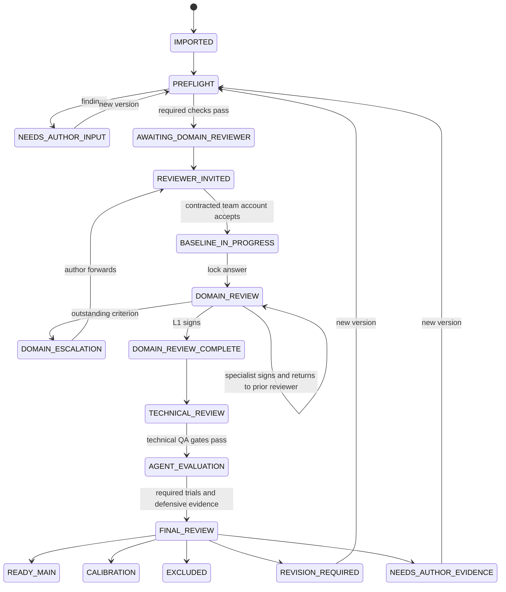

# MMB admission architecture

The Portal is a Flask application with server-rendered reviewer and author workspaces. PostgreSQL is supported for deployed ledgers and SQLite for a local, single-host instance. Account membership and role come from the operator-managed account directory. Team IDs are stable and independent of overlapping taxonomy labels.

## Persistence

| Record | Persistence |
| --- | --- |
| Teams | Eight entries in the workflow registry |
| Task | Identity, owning team, account, title, latest state and revision counter |
| Version | Immutable version row, content-addressed ZIP, per-file SHA256 and classification, Git manifest commit |
| Public and private assets | Same storage volume with separate authorization on every retrieval. Only dossier-cleared roles receive private object paths through the application. |
| Invitations, baseline, criterion verdicts, domain and technical sign-off, uncertainty transitions, checks, trials, revision and final decisions | Append-only, actor-attributed events, each carrying the task version and SHA. Latest state is a transactionally updated projection. |
| Webhooks | Repository-scoped, signature-checked delivery IDs and payload digests |

The original upload and individual files are addressed by SHA256. Archive names are validated before materialization and opaque archives embedded under data are quarantined. Filename classification is a conservative packaging check. The leakage gate still requires verification of actual file contents, mounts and image layers.

The development Git backend stores immutable version refs in a separate bare repository. The GitHub App backend writes one manifest per version to an initialized private repository. The public code repository receives only application code, published example test evidence and screenshots from public reference examples. No dossier is written to the public repository.

## State transitions

L2 and L3 use the same invitation, blind lock and review roles. The unresolved criteria and return reviewer stay attached to the task. The same account must submit and lock its independent attempt to gain dossier access. Reviewers have no access to prior version files before the new review, including by direct URL. Domain sign-off gates Technical Review. Technical and scientific defects open an evidence-linked revision issue. Further work stays with the assigned author.

The version matrix runs only Static for changes confined to the dedicated formatting notes. Verifier changes reopen the verifier controls and affected review. Scientific, data or environment changes invalidate the broader check set. Carried-forward evidence retains the SHA it was collected on. Earlier outcomes remain in the timeline. Issues stay open until a later version and explicit acceptance evidence are recorded.

Verifier rewards accept numeric 0 or 1 with no coercion. Missing, non-binary or faulted runs have a null reward and appear as invalid. Formal pass rate uses valid unhinted trials only. Final decisions require human-signed gates and evidence. All simulation records are labeled and the simulated ledger cannot route a task to Main or Excluded.

## Execution boundary

The Portal never executes uploaded Dockerfiles or scripts. Static scan uses the pinned TBS similarity and source analyzers. Run Docker and Harbor on a disposable Linux worker. Use a public-only environment build context, separate verifier mode, declared result artifacts, and an explicit no-network policy during solving and verification. The host that ingests results can hold the Portal submission credential. The untrusted execution process does not need that credential, the database URL, a GitHub token, the application key, or model provider keys.

The current execution adapter directly runs Build, Oracle and NOP. The worker API accepts version-bound verifier QA, isolation, leakage, hinted/formal trials, trace and defensive findings from a trusted evaluation harness. Automated model routing and private-run dispatch remain deployment work. The implementation does not run autonomous verifier bypass attempts. The four defensive findings are represented as test evidence.
